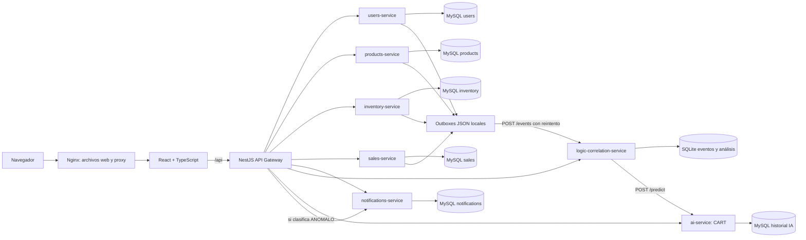

# Arquitectura y componentes

## Síntesis

SposaBella separa la interfaz, el encaminamiento HTTP, los dominios comerciales y los componentes de análisis. El gateway no reemplaza a los servicios: adapta rutas públicas a endpoints internos y realiza comprobaciones adicionales de autorización en operaciones protegidas. Los servicios de dominio mantienen bases MySQL separadas. Los eventos se entregan por HTTP desde outboxes locales al servicio de correlación; no hay un broker de mensajería declarado en la implementación.

La descripción coincide con la topología de [docker-compose.yml](../../docker-compose.yml#L1), los Dockerfiles de [servicios Node](../../infrastructure/docker/Dockerfile.service#L1), [IA](../../infrastructure/docker/Dockerfile.ai#L1) y [frontend](../../infrastructure/docker/Dockerfile.frontend#L1), y el registro de rutas de [App.tsx](../../frontend/web/src/App.tsx#L117) y [AppController](../../backend/gateway/src/app.controller.ts#L24).

## Diagrama lógico

El diagrama es lógico, no representa una garantía de atomicidad entre bases. El publicador guarda el evento en un archivo local y reintenta su entrega; ese archivo no comparte transacción con el commit MySQL del negocio. La implementación está en [event-publisher.js](../../backend/contracts/event-publisher.js#L1) y en la ingestión del [correlador](../../backend/services/logic-correlation-service/src/index.js#L29).

## Responsabilidades y tecnología comprobable

| Componente | Responsabilidad implementada | Tecnología y evidencia |
|---|---|---|
| Web | Pantallas de administración, usuarios, clientes, catálogo, compras, inventario, ventas, análisis y notificaciones. | React 19, TypeScript y Vite; [package.json](../../frontend/web/package.json#L1). |
| Nginx | Servir el frontend empaquetado y formar parte del punto de entrada Docker. | Nginx 1.27 Alpine; [Dockerfile.frontend](../../infrastructure/docker/Dockerfile.frontend#L13). |
| Gateway | Publicar rutas `/api`, propagar Bearer y solicitar validación de permisos; encadenar correlación, IA y notificación. | NestJS 11, TypeScript y Axios; [package.json](../../backend/gateway/package.json#L23), [controlador](../../backend/gateway/src/app.controller.ts#L1311). |
| users-service | Usuarios, credenciales, verificación, sesiones de actualización, roles, permisos y recuperación. | Node 22, Express, Prisma Client y MySQL; [schema](../../backend/services/users-service/prisma/schema.prisma#L1), [inicio/API](../../backend/services/users-service/src/index.js#L131). |
| products-service | Categorías, productos, variantes, SKU y precio. | Node 22, Express, Prisma y MySQL; [schema](../../backend/services/products-service/prisma/schema.prisma#L1). |
| inventory-service | Proveedores, compras, existencias y movimientos; efectúa entradas por compra y salidas asociadas a venta. | Node 22, Express, Prisma y MySQL; [schema](../../backend/services/inventory-service/prisma/schema.prisma#L1), [compras](../../backend/services/inventory-service/src/index.js#L1279). |
| sales-service | Clientes, ventas, detalles, pagos e historial de operaciones de anulación. | Node 22, Express, Prisma y MySQL; [schema](../../backend/services/sales-service/prisma/schema.prisma#L1), [rutas de venta](../../backend/services/sales-service/src/ventas.routes.js#L161). |
| notifications-service | Persistir avisos asociados a usuarios y mostrar/actualizar el estado leído. | Node/Express, Prisma y MySQL; [schema](../../backend/services/notifications-service/prisma/schema.prisma#L1), [endpoint de análisis](../../backend/services/notifications-service/src/index.js#L377). |
| logic-correlation-service | Validar e ingerir eventos, persistirlos en SQLite, calcular reglas y características, solicitar clasificación y guardar análisis. | Node 22, Express y SQLite (`node:sqlite`); [store](../../backend/services/logic-correlation-service/src/store.js#L1), [API](../../backend/services/logic-correlation-service/src/index.js#L29). |
| ai-service | Validar las 30 características del contrato, seleccionar las 16 del árbol, clasificar y devolver probabilidades/recorrido. | Python 3.12, FastAPI, pandas, scikit-learn y joblib; [Dockerfile](../../infrastructure/docker/Dockerfile.ai#L1), [dependencias](../../backend/services/ai-service/requirements.txt#L1). |

Las versiones son las declaradas por los manifiestos o imágenes, no un inventario de versiones observadas en cada máquina. Por ejemplo, Prisma aparece como 7.9.1 en los manifiestos de users y sales; MySQL 8.4 se declara en Compose. No debe inferirse que todos los servicios usan la misma biblioteca ni que un número mayor de versión de `package.json` esté bloqueado sin revisar el lockfile.

## Bases de datos y relaciones

1. **Users/MySQL**: `usuarios` se relaciona con `credenciales`, `empleados`, tokens y tablas puente `usuario_rol`; roles se relacionan con permisos mediante `rol_permiso`. Las claves foráneas son internas a esta base. Véase [schema users](../../backend/services/users-service/prisma/schema.prisma#L10).
2. **Products/MySQL**: `categorias → productos → variantes`; la FK de producto a categoría y la FK de variante a producto son locales. Véase [schema products](../../backend/services/products-service/prisma/schema.prisma#L10).
3. **Inventory/MySQL**: `proveedores → compras → detalle_compras`; `existencias` es única por `variante_producto_id`; movimientos guardan `variante_producto_id` y referencias de negocio como valores. No hay FK MySQL hacia products porque son bases distintas. Véase [schema inventory](../../backend/services/inventory-service/prisma/schema.prisma#L10).
4. **Sales/MySQL**: `clientes → ventas → detalle_ventas/pagos`. La venta conserva `cliente_id` como FK local, pero `variante_producto_id` es un identificador hacia el dominio de productos/inventario, no una relación Prisma entre bases. Las tablas de anulación agregan operación, tareas idempotentes y eventos vinculados dentro de sales. Véase [schema sales](../../backend/services/sales-service/prisma/schema.prisma#L10).
5. **Notifications/MySQL**: almacena `usuario_id` y una referencia opcional; al ser otra base, no declara FK hacia users ni hacia análisis. Véase [schema notifications](../../backend/services/notifications-service/prisma/schema.prisma#L10).
6. **Correlación/SQLite**: guarda el JSON del evento y el análisis, con IDs y timestamps indexados. No es una base operativa de ventas ni comparte transacción con las bases MySQL. Véase [store.js](../../backend/services/logic-correlation-service/src/store.js#L1).
7. **IA**: Compose configura MySQL para historial de entrenamientos; el código también permite SQLite local mediante `DATABASE_URL`. El artefacto del árbol y metadatos están en el directorio de modelos, no en tablas de cada venta. Véase [db.py](../../backend/services/ai-service/app/db.py#L1) y la configuración de [ai-service](../../docker-compose.yml#L327).

Por lo tanto, “microservicio con base independiente” no equivale a integridad referencial global. Entre servicios la coherencia se obtiene por validación de API, IDs de negocio, lógica de reintento y conciliación; se debe explicar este límite en vez de afirmar una FK distribuida.

## Autenticación, autorización y tráfico

- El login está en users-service; el frontend persiste el token de acceso y lo envía como `Authorization: Bearer`. `RequireAuth` y `RequirePermission` protegen las rutas de interfaz, pero la autorización decisiva también se realiza en backend; véase [RequirePermission](../../frontend/web/src/auth/components/RequirePermission.tsx#L21) y la validación del [Gateway](../../backend/gateway/src/app.controller.ts#L1334).
- Users calcula permisos efectivos a partir de relaciones activas de rol y permiso; ADMIN toma el catálogo de permisos disponible. La autorización se representa por permisos como `VENTAS_LEER` o `PRODUCTOS_EDITAR`, no solo por ocultar botones. Véase [permisos.js](../../backend/services/users-service/src/permisos.js#L38).
- Products valida permisos de escritura consultando `/internal/auth/validate`; el middleware falla cerrado ante falta de token, secreto interno, respuesta válida o servicio de usuarios. Véase [authorization.js](../../backend/services/products-service/src/authorization.js#L1).
- El gateway se comunica con servicios mediante HTTP/Axios, y los emisores publican eventos por HTTP. No se encontró Kafka, RabbitMQ ni un bus persistente en Compose.

## Despliegue y operación

Compose declara el frontend/Nginx, Gateway, servicios Node/Python y bases independientes. `Dockerfile.service` construye servicios Node y `Dockerfile.ai` inicia Uvicorn; estos Dockerfiles generan el cliente Prisma según el build, pero no aplican automáticamente las migraciones aditivas de apellidos. Antes de una demostración se debe confirmar esquema de cada base de prueba y seguir [README de datos demo](../../backend/scripts/demo-data/README.md).

La rama de trabajo documentada es `feature/apellidos-explicacion-cart-seed`. Las migraciones nuevas no se ejecutaron y no se debe usar `prisma db push` como sustituto sin inspeccionar el proveedor, el estado real y el procedimiento operativo.

## Justificación técnica que sí puede defenderse

La separación limita el acoplamiento de esquemas y permite que cada dominio aplique reglas de negocio propias. El Gateway centraliza rutas públicas y facilita autorización transversal. Docker Compose hace reproducible la topología local. Prisma expresa entidades y relaciones dentro de cada dominio, mientras que los eventos permiten unir hechos de distintos servicios sin imponer una FK cross-database. La selección de un árbol poco profundo facilita inspeccionar las condiciones de una clasificación. Estas son justificaciones técnicas derivadas del diseño actual, no afirmaciones sobre la motivación histórica del equipo.

