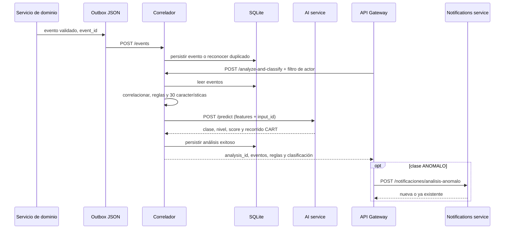

# Correlación lógica y eventos

## Evento de sistema

Un evento representa un hecho operativo ya ocurrido, no una alerta ni una clasificación. El contrato común exige `event_id`, `service`, `tipo_evento`, `entidad`, `timestamp` y `resultado`. Puede incluir `usuario_id` nulo cuando no existe actor identificable, `entidad_id`, `ip` y un `metadata` limitado a valores simples. El esquema rechaza propiedades no declaradas y restringe los nombres y tamaños; véase [system-event.schema.json](../../backend/contracts/system-event.schema.json#L1) y su validador [system-event.js](../../backend/contracts/system-event.js#L11).

Ejemplo conceptual (valores ficticios):

```json
{
  "event_id": "evt-demo-001",
  "service": "sales-service",
  "usuario_id": 101,
  "tipo_evento": "VENTA_CREADA",
  "entidad": "venta",
  "entidad_id": "500",
  "timestamp": "2026-11-25T10:02:00.000Z",
  "resultado": "EXITOSO",
  "metadata": {}
}
```

El contrato no contiene nombre, correo ni teléfono del cliente. El objetivo es preservar referencias operativas suficientes para relacionar hechos, reduciendo datos personales que no necesita este análisis.

## Recepción, validación y almacenamiento

1. Los servicios de dominio crean un evento a través del publicador común. Este valida la carga y escribe el evento en un outbox JSON local antes de intentar la entrega.
2. El publicador envía `POST /events` al correlador con timeout. Retira del outbox únicamente el primer evento confirmado con el mismo `event_id` y estado de ingesta esperado. Si hay error, conserva el evento para reintento.
3. El correlador vuelve a validar el contrato. Responde `201` para nuevo, `200` para duplicado idéntico, `409` para reutilización del mismo ID con contenido diferente y `503` si no puede persistir.
4. SQLite guarda `event_id` como clave primaria, evento JSON, metadata, actor y timestamps con índices. Las respuestas HTTP no sustituyen la comprobación de persistencia.
5. El endpoint de análisis puede tomar eventos enviados con la solicitud o leer eventos persistidos según filtros. Rechaza mezclar varios actores si no se filtra usuario, y permite la categoría anónima explícita.

Implementación: [publicador](../../backend/contracts/event-publisher.js#L81), [ingesta](../../backend/services/logic-correlation-service/src/index.js#L29), [resolución de entrada](../../backend/services/logic-correlation-service/src/index.js#L81), [store SQLite](../../backend/services/logic-correlation-service/src/store.js#L1).

### Límite del outbox

El outbox local hace reintentable la entrega, pero no es una outbox transaccional en MySQL. Un proceso puede confirmar la operación comercial y caer antes de que el archivo del evento se escriba. Por tanto, el sistema no demuestra entrega exactly-once: usa IDs idempotentes para reducir duplicados y reintentos, pero debe contemplar reconciliación ante pérdida o fallo parcial.

## Ventanas y reglas verificadas

Las ventanas se calculan respecto de `reference_timestamp` o del evento más reciente, usando intervalos inclusivos en el inicio y fin. El servicio calcula ventanas de 5, 10 y 30 minutos para el endpoint actual; el contrato de constantes también define 60 minutos. Eventos se ordenan por fecha y se deduplican por `event_id`. Implementación: [ventanas y reglas](../../backend/services/logic-correlation-service/src/correlation.js#L14), [features](../../backend/services/logic-correlation-service/src/correlation.js#L194), [constantes](../../backend/services/logic-correlation-service/src/constants.js#L1).

| Código | Condición real | Interpretación |
|---|---|---|
| R1 | Al menos 5 `LOGIN_FALLIDO` con resultado fallido en 10 minutos. | Señal determinista de intentos fallidos repetidos. |
| R2 | Al menos 3 `VENTA_ANULADA` no fallidas en 30 minutos. | Señal de anulaciones repetidas. |
| R3 | Existe una salida de stock con `referencia_tipo=VENTA`, `tipo_movimiento=SALIDA` y `venta_id` que coincide con `entidad_id` de `VENTA_CREADA`; la salida ocurre después, en menos de 15 minutos y con actor compatible cuando ambos están presentes. | Relación comercial esperada venta→stock. No es señal de riesgo por sí sola. |
| R4 | Cuenta ventas precedidas por cambios de precio en menos de 15 minutos. El objeto de regla queda `fired=false`. | Contexto temporal informativo, no regla que active riesgo. |
| R5 | Al menos 3 acciones administrativas exitosas en 10 minutos: creación/modificación/desactivación de usuario o cambio de rol. | Señal determinista de actividad administrativa concentrada. |
| R6 | Se activaron al menos 2 de R1, R2 y R5. | Combinación de señales deterministas; no es una clase CART. |

El código de R3 requiere una diferencia `gap >= 0 && gap < 15 min`; esto significa que el movimiento debe ocurrir después de la venta. No usa una diferencia absoluta. La frase “diferencia temporal absoluta” que aparece en el README del correlador es imprecisa y se audita en [auditoría documental](./08_auditoria_coherencia_documental.md).

## Cómo se construyen características

El correlador:

- cuenta logins, ventas, cancelaciones, movimientos de stock, cambios de precio y acciones administrativas en ventanas;
- calcula proporciones de login fallido y cancelación;
- asocia ventas y movimientos con ID, actor compatible y tiempo;
- excluye ventas anuladas y ventas todavía no maduras de `sales_without_stock_link_count`;
- calcula secuencias y entidades distintas;
- exporta 30 columnas para el contrato con IA.

La lógica está en [correlation.js](../../backend/services/logic-correlation-service/src/correlation.js#L194). El servicio de IA comprueba paridad de extracción en [test_features.py](../../backend/services/ai-service/tests/test_features.py) y obtiene las mismas características en [features.py](../../backend/services/ai-service/app/features.py#L201).

De esas 30 características, el CART consume las 16 listadas en el [capítulo de IA](./04_explicacion_inteligencia_artificial.md#variables-de-entrada-distinguir-30-del-subconjunto-cart). Las 30 banderas/relaciones son contexto del correlador; no todas son variables de entrada. R1–R6 tampoco son el resultado del árbol.

## Secuencia de clasificación e integración



El endpoint es implementado en [index.js del correlador](../../backend/services/logic-correlation-service/src/index.js#L180). El Gateway asocia `analysis_id` con `input_id`, y solicita notificación solo para `ANOMALO`; véase [AppController](../../backend/gateway/src/app.controller.ts#L784). Si la respuesta de IA está mal formada, falla o no se persiste, el flujo no debe presentarse como clasificación completa.

## Tres evidencias separadas para la defensa

1. **Reglas lógicas**: una descripción y un booleano/valor (por ejemplo, R1 activada, valor 5).
2. **Recorrido CART**: nodos realmente visitados por el artefacto entrenado, sus valores y condiciones, la rama y la hoja final.
3. **Evidencias de eventos**: IDs, tipo, servicio, entidad, actor y timestamp, conservados para contextualizar el resultado.

La clase (`NORMAL`/`ANOMALO`) y el nivel de riesgo son salida del modelo y de la capa de presentación. No equivalen a regla ni a evidencia. La UI presenta cada grupo en secciones distintas en [DetectionPage](../../frontend/web/src/analysis/pages/DetectionPage.tsx#L478).

