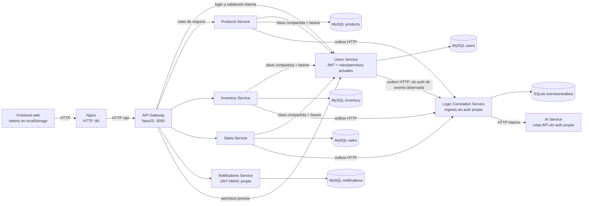
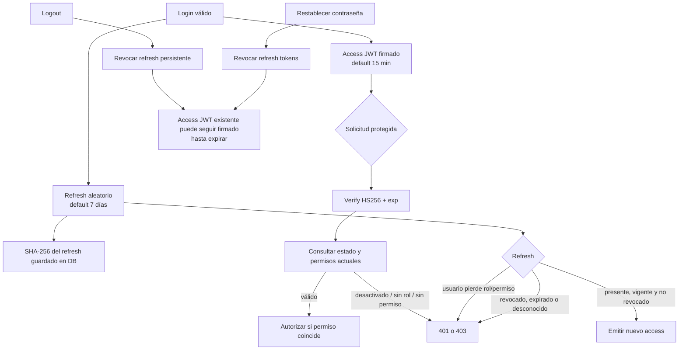
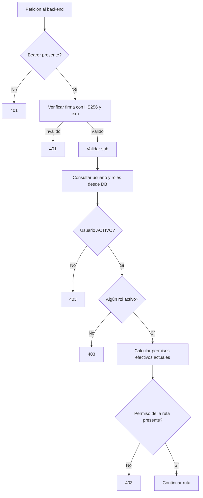

# Diagramas de seguridad de SposaBella

Los siguientes diagramas son editables y reflejan la configuración/código inspeccionados. Son diagramas conceptuales derivados de evidencia, no una captura de un sistema ejecutándose. El entorno de Compose representa desarrollo; el documento no infiere una arquitectura productiva.

## Figura 1. Arquitectura general de seguridad



**Interpretación:** el gateway y los servicios de dominio se comunican por HTTP sobre la red bridge declarada. Las líneas que llegan a `users-service` para decisiones de permiso usan la cabecera compartida y un bearer de usuario; la publicación de eventos no incluye un mecanismo de autenticación de productor en el código revisado. Las rutas de correlación/IA dependen del aislamiento de red y no validan por sí mismas un principal en sus endpoints inspeccionados.

## Figura 2. Secuencia de autenticación y autorización dinámica

```mermaid
sequenceDiagram
  actor U as Usuario
  participant F as Frontend
  participant G as API Gateway
  participant US as Users Service
  participant DB as MySQL users
  participant S as Servicio protegido

  U->>F: Introduce correo y contraseña
  F->>G: POST /api/users/auth/login
  G->>US: POST /auth/login + IP de cliente confiable
  US->>DB: Buscar usuario, credencial y roles
  DB-->>US: Cuenta, hash bcrypt y estado
  US->>US: bcrypt.compare y validar cuenta verificada/activa
  US->>DB: Consultar contexto actual de roles y permisos
  DB-->>US: Roles activos y permisos
  alt credenciales y autorización inicial válidas
    US->>US: Firmar access JWT HS256; crear refresh aleatorio
    US->>DB: Guardar hash SHA-256 del refresh y expiración
    US-->>G: Access JWT + refresh token + perfil
    G-->>F: Respuesta de login
    F->>F: Guardar tokens en localStorage
    F->>G: Solicitar recurso con Authorization: Bearer
    G->>S: Reenviar bearer
    S->>US: POST /internal/auth/validate + clave compartida<br/>permiso requerido
    US->>US: Verificar HS256 y exp
    US->>DB: Consultar de nuevo usuario, roles y permisos actuales
    DB-->>US: Contexto actual
    US-->>S: 200 valid=true o 401/403
    S-->>G: Resultado autorizado o rechazo
    G-->>F: Respuesta del recurso
  else cuenta, credencial o permiso no válido
    US-->>G: 401/403
    G-->>F: Error de autenticación
  end
```

**Interpretación:** se muestra la lógica del código, no una transacción capturada en ejecución. La autorización de un servicio es una consulta adicional; el JWT por sí solo no contiene la decisión final de permisos.

## Figura 3. Ciclo de vida y límites del token



**Nota:** el refresh token no se rota en el endpoint revisado. El diagrama distingue revocar la capacidad de renovar de invalidar criptográficamente los access JWT existentes.

## Figura 4. Flujo de evento y clasificación

```mermaid
sequenceDiagram
  participant D as Servicio de dominio
  participant O as Outbox local
  participant C as Logic Correlation Service
  participant DB as SQLite
  participant AI as AI Service

  D->>D: Construir evento y actor
  D->>D: Validar contrato y retirar metadata sensible por nombre
  D->>O: Persistir evento pendiente
  O->>C: POST /events por HTTP
  Note over O,C: El código inspeccionado no adjunta credencial específica del evento
  C->>C: Validar esquema y deduplicar event_id
  C->>DB: INSERT parametrizado; detectar duplicado/conflicto
  C-->>O: Confirmar event_id/estado
  O->>O: Retirar de cola solo con acuse coincidente
  C->>C: Correlacionar eventos del actor
  C->>AI: POST /predict por HTTP
  AI-->>C: Clasificación experimental
```

**Interpretación:** contrato, reintento e idempotencia mejoran consistencia, pero no certifican la identidad o integridad criptográfica del productor. Las etiquetas y ejemplos sintéticos no son operaciones reales.

## Figura 5. Flujo de verificación de acceso



Este flujo representa `users-service` y los servicios que consultan su endpoint interno. No debe extrapolarse automáticamente al middleware propio de `notifications-service` ni a las rutas de correlación/IA.
